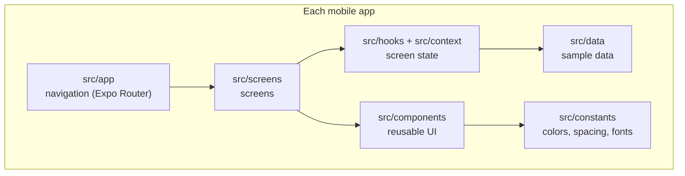
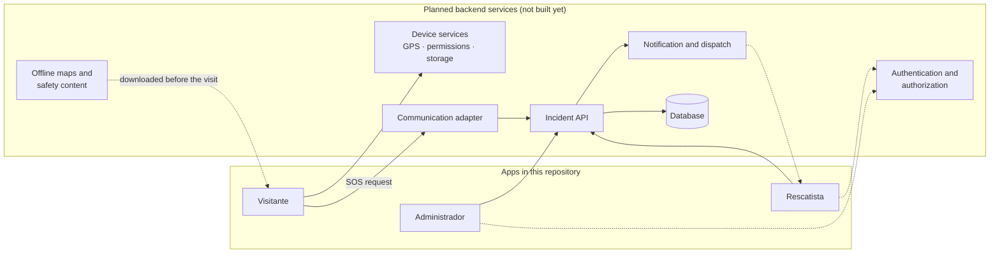

# Más Bosque Manu

Safety app concept for visitors of **Bosque La Primavera** (Jalisco, Mexico), a natural
area with limited connectivity.

## Scope of this stage

This repository is the **app skeleton (Stage 3)**: the screens and the navigation we
designed in Stage 2, built in code.

- **It is only screens and navigation.** Buttons take you from one screen to the next,
  and the screens show the states we designed (no GPS, no connection, empty lists…).
- **There is no real functionality yet**: no backend, no storage, no accounts, no GPS
  and no real alerts. Everything shown on screen is fictional sample data stored in the
  code (`src/data/`).
- Backend services are not built in this stage. We only name the ones we plan to use
  (see [Architecture](#architecture)); their technologies will be chosen later.

**Team:** León Daniel Vilchis Arceo · Jorge Cardenas Blanco · Carlos Eduardo López
Cuevas · Carlos Gerardo Gouyonnet Sánchez. Mobile Development, Tecnológico de Monterrey.

---

## The three apps

| App | Folder | Platform | Screens |
|---|---|---|---|
| **Visitante** (visitor) | `apps/visitor` | Android / iOS (Expo) | V01–V14: welcome, permissions, home, SOS flow, offline map, medical kit, safety tips |
| **Rescatista** (rescuer) | `apps/rescuer` | Android / iOS (Expo) | R01–R09: sign in, alerts, incident detail, map, status update, follow-up, close, offline |
| **Administrador** (admin) | `apps/admin` | Web (React) | A01–A09: sign in, dashboard, incidents, teams, map points, content, reports, settings, error |

The visual reference is our Stage 2 Figma export in `references/`.

## Tech stack

| | Mobile apps (visitor, rescuer) | Admin panel |
|---|---|---|
| Framework | React Native + **Expo SDK 58** | React 19 + **Vite** |
| Language | TypeScript | TypeScript |
| Navigation | **Expo Router** | React Router |
| Icons | `@expo/vector-icons`, `react-native-svg` | `lucide-react` |

The app UI is in Spanish; code and docs are in English.

## Navigation: why Expo Router

We use **Expo Router** for both mobile apps instead of setting up React Navigation by
hand:

- **The folder `src/app/` is the navigation.** Each file is a screen route
  (`src/app/sos/estado.tsx` → `/sos/estado`), so the code mirrors the navigation map we
  drew in Stage 2.
- **Typed routes**: a link to a screen that does not exist fails at compile time.
- **Stacks and tabs out of the box**: Expo Router is built on React Navigation, so we
  still get native stacks and bottom tabs.
- It is Expo's **default and recommended** option and works with Expo Go.

The admin panel is a web app, so it uses React Router. More detail in
[`docs/DECISIONS.md`](docs/DECISIONS.md).

## Architecture



### Planned backend services

Taken from our Stage 2 design. **None of them is built in this stage**; for now every
screen uses sample data.



What each service will do is described in
[`docs/ARCHITECTURE.md`](docs/ARCHITECTURE.md#6-planned-backend-services), together with
the navigation diagrams of the three apps.

## Repository structure

```text
MasBosqueManu/
├── apps/
│   ├── visitor/        Visitor mobile app (Expo)
│   ├── rescuer/        Rescuer mobile app (Expo)
│   └── admin/          Admin web panel (Vite)
├── docs/
│   ├── ARCHITECTURE.md Component structure and navigation diagrams
│   └── DECISIONS.md    Architecture decisions
├── references/         Stage 2 Figma export (PDF and PNG)
├── .gitignore
└── README.md
```

### Inside a mobile app

```text
apps/visitor/src/
├── app/            Navigation: layouts (stack, tabs) and one file per route
├── screens/        One component per screen, grouped by feature
├── components/     Reusable UI: buttons, cards, notices, map drawing, tab bar
├── constants/      Colors, spacing and font sizes from the design
├── data/           Sample data shown on the screens
├── types/          TypeScript types for that data
├── context/        Shared screen state (React Context)
└── hooks/          useDemo() to read that state
```

| Folder | What goes there | Folder seen in class |
|---|---|---|
| `src/app/` | Routes and navigators. Route files only point to a screen | `/navigation` |
| `src/screens/` | Screen components | `/screens` |
| `src/components/` | Reusable components | `/components` |
| `src/constants/` | Theme values | `/constants` |
| `src/data/` | Sample data | `/data` |
| `src/hooks/` | Custom hooks | `/hooks` |

The rescuer app uses the same layout. The admin panel has `navigation/`, `pages/`,
`components/`, `constants/`, `data/`, `types/`, `context/` and `hooks/`.

## Getting started

Requirements: **Node.js 20+**, **npm 10+**, and Android Studio with an emulator or a
phone with **Expo Go** for the mobile apps.

```bash
# Install (each app has its own dependencies)
cd apps/visitor && npm install
cd ../rescuer  && npm install
cd ../admin    && npm install

# Visitor app
cd apps/visitor
npx expo start --android

# Rescuer app (another port, so it can run next to the visitor app)
cd apps/rescuer
npx expo start --port 8082 --android

# Admin panel (http://localhost:5173)
cd apps/admin
npm run dev
```

The sign-in screens accept any username and password.

### Seeing every screen state

Some screens have several designed versions (for example, the map with and without GPS).
To switch between them without editing code:

| App | Where |
|---|---|
| Visitor | Tap the amber **"Prototipo académico"** strip at the top of any screen |
| Rescuer | **Perfil** tab |
| Admin | **Configuración** section |

### Checks

```bash
# Mobile apps
npm run typecheck
npx eslint .

# Admin panel
npm run check     # TypeScript, ESLint and a test that renders every page
npm run build
```
