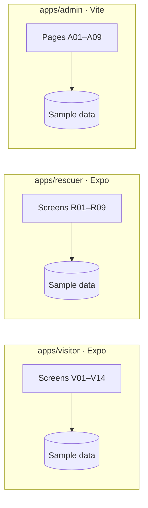
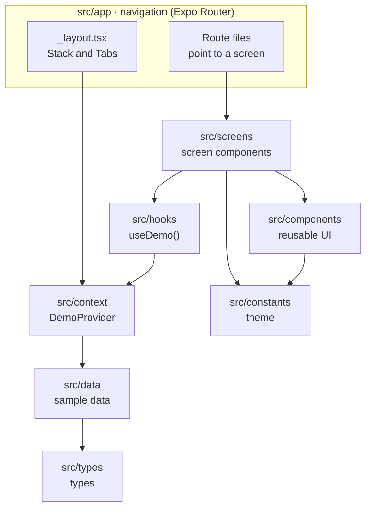
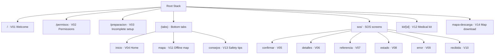
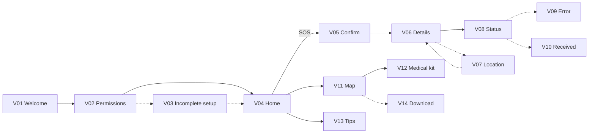
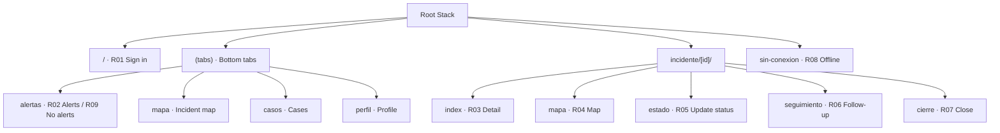
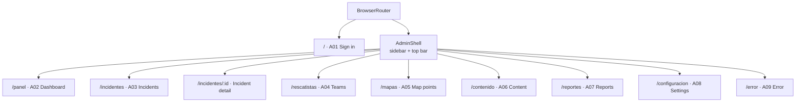
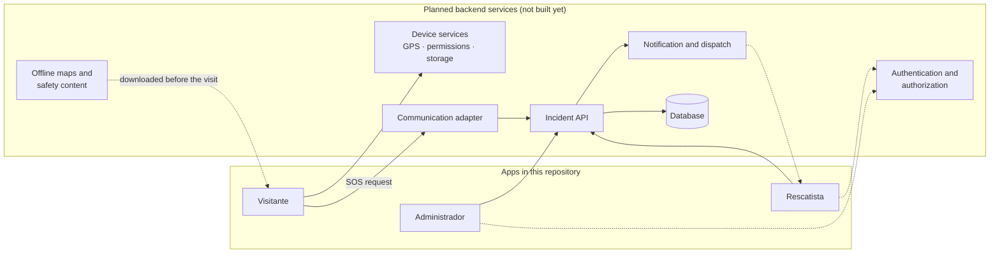

# Architecture — Más Bosque Manu

Stage 3 covers the **screens and navigation** only. There is no backend or storage yet:
every screen reads fictional sample data from `src/data/`. The backend services we plan
to add later are named in [section 6](#6-planned-backend-services).

## 1. Overview

The three apps are independent: each one has its own dependencies, its own sample data
and runs on its own. They do not talk to each other.

## 2. Component structure

Both mobile apps are organized the same way. Arrows mean "uses".

- **Route files are one line.** `src/app/sos/estado.tsx` only contains
  `export { default } from '@/screens/sos/emergency-status-screen';`. The navigation tree
  stays easy to read, and screens can be renamed without changing the URL.
- **Screens** build the UI from **components** and read sample data through
  `useDemo()`.
- **Components** only receive props and use the theme from `src/constants/`.

The admin panel follows the same idea with web names: `src/navigation/` holds the
React Router routes, `src/pages/` the screens, and `src/index.css` the theme colors.

## 3. Navigation

### Visitor

Main path between screens:

### Rescuer

Main path from the design: `R01 → R02 → R03 → R04` and `R03 → R05 → R06 → R07`.
Until the user signs in on R01, only the sign-in screen is available.

### Admin

The sidebar links every section with every other one (`A02 ↔ A03 … A08`).

## 4. Screen state

Each app has one React Context (`src/context/`) that keeps, in memory, the sample data
and which version of each screen to show. It is only there to move between the
designed screens: nothing is saved, and reloading the app resets it.

## 5. Dependencies added to the templates

| Package | App | Used for |
|---|---|---|
| `react-native-svg` | visitor, rescuer | Map drawings and illustrations |
| `@expo/vector-icons` | visitor, rescuer | Icons |
| `react-router-dom` | admin | Routes |
| `lucide-react` | admin | Icons |

## 6. Planned backend services

These are the backend services we plan to use, taken from our Stage 2 design. **None of
them is built in this stage**, and their technologies have not been chosen yet.

| Service | What it will do | Used by |
|---|---|---|
| Device services | GPS, location permission and local storage on the phone | Visitor |
| Offline maps and safety content | Maps and tips downloaded before entering the forest | Visitor |
| Communication adapter | Sends the SOS over the available channel and reports the result (BLE, Wi-Fi or LoRaWAN, to be decided) | Visitor |
| Incident API | Receives SOS requests and keeps their status and history | All three apps |
| Notification and dispatch | Notifies rescuers about confirmed incidents | Rescuer, admin |
| Authentication and authorization | Sign-in and roles for staff; visitors never need an account | Rescuer, admin |
| Database | Incidents, accounts and content; only the API reads it | Incident API |
